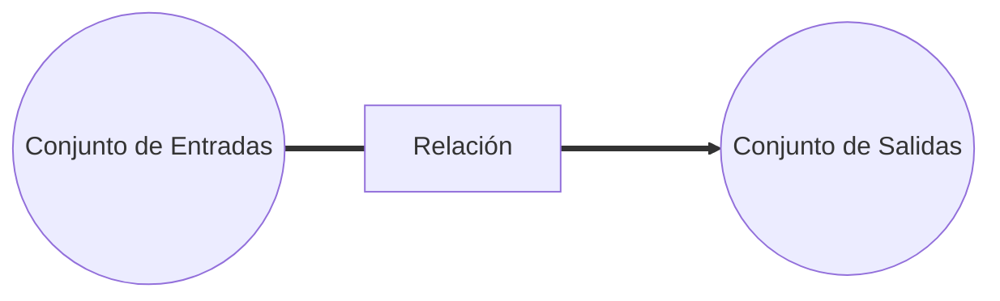

# Definición de sistemas

Un sistema es una **combinación de  componentes** que actúan conjuntamente para determinado objetivo 
Otra definición es. la combinación de elementos o componentes que actúan de manera conjunta para realizar una función perfectamente definida, que no podría ser llevada a cabo por alguno de los elementos que lo componen de forma individual.

Los Sistemas son conjuntos que interaccionan entre sí a través de una relación bien definida entre ambos conjuntos.

**Nota:** Cable aclarar que esta definición aplica para **sistemas dinámicos**. Existen múltiples ámbitos en los que aplicar la definición de sistemas, social y económicamente es posible definirlos de forma distinta.
**Ejemplo 1.**

![[Pasted image 20240209160836.png]]
## Componente

Un componente, como su nombre lo indica, es una parte del sistema, una unidad particular que cumple determinada función en el sistema.
En el ejemplo 1, analizamos los componentes del sistema (tornillos, lámina, llantas, aceite, remaches, vidrios, motores, etc.)

# ![[Clasificación de Sistemas]]

[[Linealidad de un sistema]]

